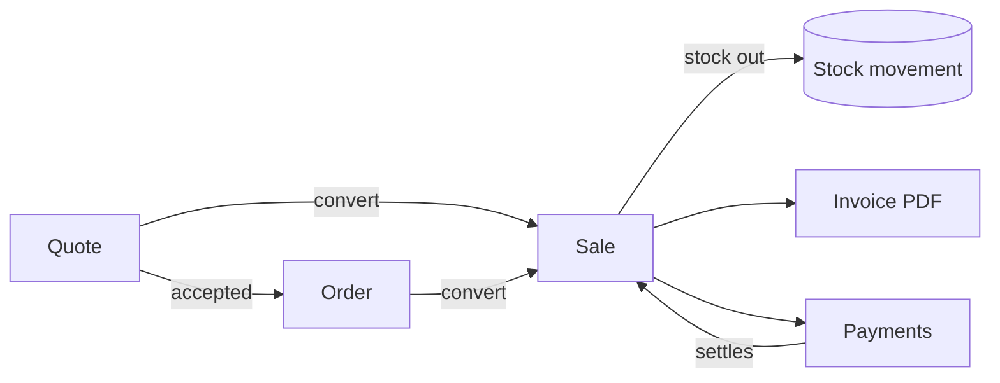
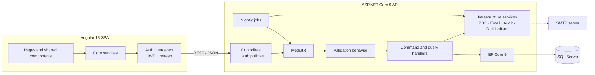

<div align="center">

# GestionCo

**A full-stack commercial management ERP for small and mid-sized businesses**

Quotes · Orders · Sales · Invoicing · Purchasing · Inventory · Expenses · Financial reporting


</div>

---

## Overview

GestionCo is a web ERP that covers the full commercial cycle of a trading company: from the first quote sent to a customer, to the cash collected, the stock movement it triggered and the VAT it generated.

I built it as my final-year internship project (PFE, 2026) for the needs of a Moroccan SME. Amounts are in MAD, VAT is applied per line, and generated invoices carry the company's legal identifiers (ICE, RC, IF, Patente, CNSS). The user interface is in French.

| | |
|---|---|
| **123** REST endpoints across 21 controllers | **25** domain entities |
| **69** automated API acceptance scenarios | **26** lazy-loaded Angular screens |
| **2** roles enforced on both API and UI | **2** scheduled background jobs |

## Features

### Sales cycle



- **Quotes**: drafts, PDF sent by email, status tracking (draft, sent, accepted, refused, expired), conversion into an order or directly into a sale.
- **Orders**: confirmation and delivery tracking (not started, preparing, out for delivery, delivered). A second conversion of the same order is rejected.
- **Sales**: line-level discounts and VAT, stock availability check, due date computed from the customer's payment terms, partial payments.
- **Invoices**: generated from sales as branded PDFs (company logo and legal identifiers) and emailed as attachments over SMTP.
- **Payments**: cash, card, bank transfer or cheque. Partial and full settlements update document status automatically.

### Purchasing and inventory

- Supplier purchases with partial payments.
- Every stock change is recorded as a traceable movement: purchase, sale, cancellation, edit or manual adjustment.
- **Automatic replenishment**: when a sale drops a product below its alert threshold, the system raises a stock alert and drafts a purchase order for the product's supplier. Duplicate pending orders within 7 days are skipped.

### Finance

- Expenses by category, including **recurring expenses** generated by a nightly job.
- Reports: profit and loss, VAT (both exportable to PDF), monthly cash flow and aged receivables.
- Dashboard with KPIs, a sales trend chart, top products, stock alerts and the latest sales.

### Platform

- Global search across customers, suppliers, products, quotes, sales, purchases and invoices.
- In-app notifications (new sale, low stock, replenishment, payments due today or overdue).
- Audit log of every sensitive action, with user, timestamp, IP address and user agent (admin only).
- Excel import for customers, suppliers and products, and Excel export of lists.
- Configurable company profile, logo, document numbering (prefix and optional year), default VAT, payment terms and SMTP.
- Dark mode, and automatic logout after 60 minutes of inactivity, synchronised across browser tabs.

## Technical highlights

### Backend (ASP.NET Core 9)

- **Clean Architecture** layering (Api, Application, Domain, Infrastructure) with the Application layer organised by feature.
- **CQRS with MediatR**: each use case is a command or query with its own handler. **FluentValidation** runs automatically through a MediatR pipeline behavior.
- **Centralised exception middleware** that maps domain exceptions (validation, not found, business rule) to consistent HTTP responses.
- **EF Core 9** on SQL Server with fluent configurations and auditable entities (created/updated by and at).
- **Hosted background services**: recurring expense generation, with a catch-up run at startup in case the server was down at midnight, and payment due-date reminders, deduplicated to one per sale per day.
- **Server-side PDF generation** with QuestPDF for invoices, quotes, P&L and VAT reports. Email delivery with MailKit.
- Swagger / OpenAPI documentation with JWT support in development.

### Security

- Short-lived JWT access tokens (15 min, no clock skew) and **rotating refresh tokens** (7 days). A refresh token that has already been used is rejected.
- Passwords hashed with **BCrypt**.
- Role-based authorization policies (`AdminOnly`, `AdminOrManager`) on every controller.
- **Brute-force protection**: after 5 failed logins from the same IP within 15 minutes, the API answers HTTP 429.
- The API refuses to start in production with a weak or default JWT signing key. HTTPS and HSTS are enforced outside development.

### Frontend (Angular 18)

- **Standalone components**, with every screen lazy-loaded through `loadComponent`.
- Functional route guards (`authGuard`, `adminGuard`, `guestGuard`) and a functional HTTP interceptor.
- **Transparent token refresh**: on a 401, concurrent requests wait for a single refresh, coordinated across tabs with the **Web Locks API** so a rotated refresh token is never sent twice.
- Reusable UI components: modal, pagination, date range picker, toasts, notification bell and global search.
- Role-aware UI (destructive actions hidden for managers), always backed by server-side policies.

## Architecture



## Tech stack

| Layer | Technologies |
|---|---|
| Frontend | Angular 18, TypeScript 5.5, RxJS, SheetJS (Excel import/export) |
| Backend | .NET 9, ASP.NET Core Web API, MediatR 12, FluentValidation 11 |
| Data | SQL Server, Entity Framework Core 9 |
| Security | JWT Bearer, BCrypt, role-based policies, login rate limiting |
| Documents | QuestPDF, MailKit |
| API docs | Swagger / OpenAPI (Swashbuckle) |
| Testing | Node.js end-to-end API acceptance suite |

## Getting started

### Prerequisites

- [.NET 9 SDK](https://dotnet.microsoft.com/download/dotnet/9.0)
- [Node.js](https://nodejs.org/) 18.19 or later, with npm
- SQL Server (Developer, Express or LocalDB)

### 1. Clone

```bash
git clone https://github.com/AyoubBellaoui/GestionCo.git
cd GestionCo
```

### 2. Run the API

```bash
cd backend/GestionCo.Api
dotnet run
```

- API: http://localhost:5000
- Swagger UI: http://localhost:5000/swagger

On first start the database is created and seeded automatically with an admin account and default product and expense categories. The default connection string targets a local SQL Server with Windows authentication. To use another instance, edit `ConnectionStrings:Default` in `appsettings.json` or set the `ConnectionStrings__Default` environment variable, for example `Server=.\SQLEXPRESS;...` or `Server=(localdb)\MSSQLLocalDB;...`.

### 3. Run the frontend

```bash
cd frontend
npm install
npm start
```

The app runs at http://localhost:4200. The dev server proxies `/api` to the API on port 5000.

### 4. Sign in

| Role | Email | Password |
|---|---|---|
| Admin | `admin@gestionco.ma` | `Admin123!` |

Manager accounts are created by the admin from **Paramètres → Utilisateurs**.

> [!IMPORTANT]
> These are local demo credentials. Before deploying, change the admin password and set a strong signing key (at least 32 characters) through the `JwtSettings__SecretKey` environment variable. The API will not start in production with the default key.

## Testing

The repository includes an end-to-end acceptance suite that drives the real API over HTTP. It needs Node.js 18+ and no extra dependencies.

```bash
# API running against an empty test database (the suite creates its own data)
node tests/recette-api.mjs http://localhost:5000 report.json
```

The 69 scenarios cover authentication, role permissions, catalogue, quotes, orders, sales, stock, invoicing, payments, expenses, reports, notifications, audit log and login rate limiting. Each case prints the expected and actual result. The JSON report adds response-time statistics (mean, median, p95, max), and the script exits with a non-zero code on any failure, so it can gate a CI pipeline.

## Roles and permissions

| Capability | Admin | Manager |
|---|:-:|:-:|
| Quotes, orders, sales, purchases, payments | ✅ | ✅ |
| Create and edit products, customers, suppliers, categories | ✅ | ✅ |
| Manual stock adjustments | ✅ | ✅ |
| Dashboard and financial reports | ✅ | ✅ |
| Cancel a sale or a purchase | ✅ | ❌ |
| Delete products, customers, suppliers, categories | ✅ | ❌ |
| User management | ✅ | ❌ |
| Settings (company, numbering, SMTP) | ✅ | ❌ |
| Audit log | ✅ | ❌ |

Permissions are enforced by authorization policies on the API, and mirrored in the UI by route guards and conditional actions.

## Project structure

```
GestionCo/
├── backend/GestionCo.Api/
│   ├── Api/              # Controllers and exception middleware
│   ├── Application/      # One folder per feature: commands, queries, DTOs, validators
│   ├── Domain/           # Entities, enums, auditable base entity
│   ├── Infrastructure/   # EF Core, JWT, PDF, email, background jobs, seed data
│   └── Program.cs        # DI, authentication, CORS, Swagger, database bootstrap
├── frontend/src/app/
│   ├── core/             # Guards, interceptor, services, models
│   ├── layout/           # Application shell
│   ├── pages/            # One lazy-loaded component per screen
│   └── shared/           # Reusable UI components
└── tests/
    └── recette-api.mjs   # API acceptance suite
```

## Email configuration

Quotes and invoices are emailed as PDF attachments. SMTP is configured from the UI by an admin under **Paramètres → Email SMTP**, stored in the database rather than in source code, and can be checked with the built-in **send test email** action.

| Provider | Host | Port |
|---|---|---|
| Gmail | `smtp.gmail.com` | 587 |
| Outlook / Office 365 | `smtp.office365.com` | 587 |
| Brevo | `smtp-relay.brevo.com` | 587 |
| Mailtrap (testing) | `sandbox.smtp.mailtrap.io` | 587 |

Gmail requires an [App Password](https://myaccount.google.com/apppasswords) (2-step verification must be enabled). Other providers use the SMTP credentials they issue.

## Roadmap

- Docker Compose setup for the API, SQL Server and frontend
- GitHub Actions pipeline running the build and the acceptance suite
- Unit tests for the application handlers (xUnit)
- English localisation of the interface

## Author

**Ayoub Bellaoui** · [GitHub](https://github.com/AyoubBellaoui)
